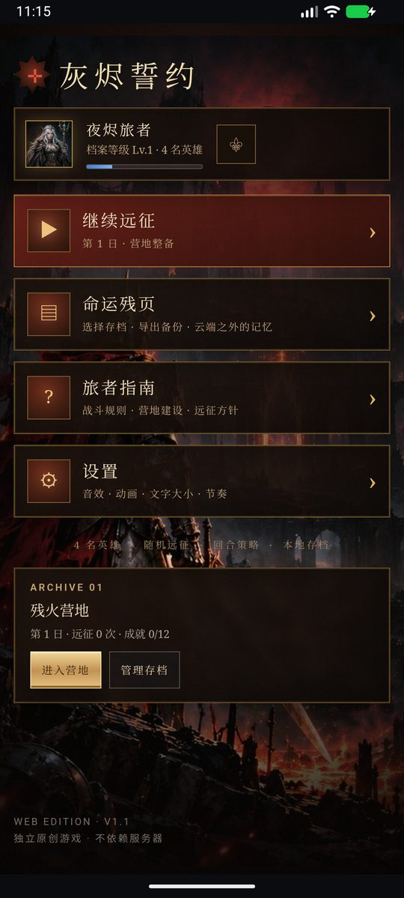
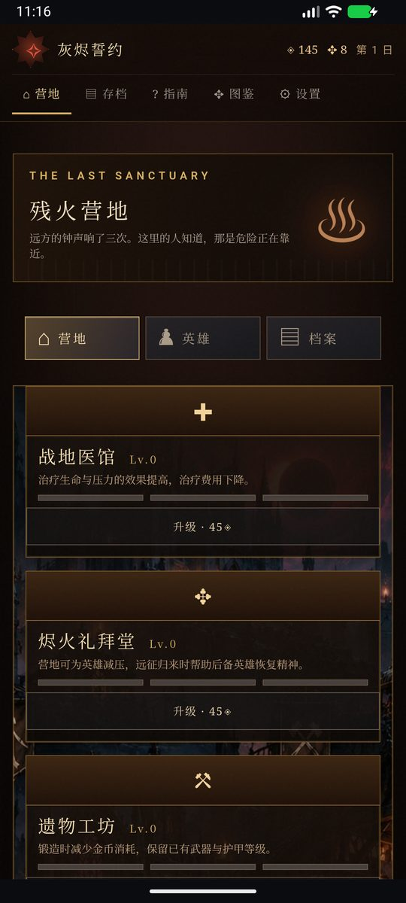
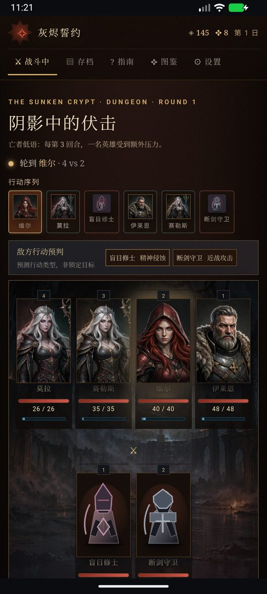

# 灰烬誓约 · Android 工程

把原有的纯网页版《灰烬誓约》（单文件 `ashen-vow-play-v1.0.html`）封装成**可安装、可离线运行的原生安卓应用**。

- 应用名：灰烬誓约
- 包名：`com.ashenvow.game`
- 版本：1.1.0（versionCode 11000）
- 最低系统：Android 6.0（API 23）；目标版本 Android 14（API 34）
- 权限：**零权限**（无网络、无存储、无相机），全程离线
- 安装包体积：约 3.4 MB（内含 4.3 MB 单文件游戏页面，压缩后 3.1 MB）

| 主菜单 | 营地 | 战斗 |
| --- | --- | --- |
|  |  |  |

> 截图取自 Android 16 模拟器（1080×2400）实机运行，非设计稿。

---

## 一、改造后的目录结构

```
网页优化/
├── ashenvow-src/                        ← 网页版源码（游戏本体，保持原样）
│   ├── ashen-vow-play-v1.0.html            单文件构建产物（含内联 CSS/JS/图片）
│   └── ashen-vow-web/                      网页工程：src/*.js、style.css、tests/
│
└── android/                             ← 本次新增：安卓工程（可独立用 Android Studio 打开）
    ├── settings.gradle.kts                模块声明 + 依赖仓库
    ├── build.gradle.kts                   顶层构建脚本（AGP 8.5.2）
    ├── gradle.properties                  构建参数 / 中文路径放行 / UTF-8
    ├── local.properties                   Android SDK 路径（本机路径，勿提交）
    ├── gradlew、gradlew.bat               Gradle Wrapper（固定 Gradle 8.9）
    ├── gradle/wrapper/                    Wrapper 用的 jar 与 distributionUrl
    │
    ├── build-apk.bat                      Windows 一键打包（自动找 JDK 17+，产出 dist/）
    ├── build-apk.sh                       macOS / Linux 一键打包
    ├── install-run.bat                    安装到已连接设备并启动
    ├── keystore.properties                发布签名配置（指向下面的 jks）
    ├── keystore/ashen-release.jks         发布证书（开发用，见第五节）
    ├── scripts/gen_icons.py               用 Pillow 生成全套应用图标（可重跑）
    ├── docs/                              运行截图
    ├── dist/                              打包产物：ashen-vow-debug.apk / ashen-vow-release.apk
    │
    └── app/                               ← 唯一的应用模块
        ├── build.gradle.kts               applicationId、版本号、签名、资源同步任务
        ├── proguard-rules.pro             混淆规则（壳层无反射，基本用不到）
        └── src/main/
            ├── AndroidManifest.xml        清单：单 Activity、竖屏、无权限、无明文流量
            ├── java/com/ashenvow/game/
            │   ├── MainActivity.java      应用入口：WebView 生命周期、返回键、错误兜底
            │   └── LocalWebViewClient.java 把虚拟 https 域名的请求映射到 assets/www
            ├── assets/www/index.html      游戏本体（构建时由网页产物自动同步）
            └── res/
                ├── layout/activity_main.xml     全屏 WebView + 原生错误页
                ├── values/                      颜色 / 文案 / 主题
                ├── values-v31/themes.xml        Android 12+ 系统启动页
                ├── drawable/splash_background.xml 冷启动背景（纯色 + 徽记）
                ├── drawable-nodpi/splash_mark.png 启动徽记
                ├── mipmap-anydpi-v26/           自适应图标（Android 8+）
                ├── mipmap-anydpi-v33/           带 monochrome 层的自适应图标（Android 13+）
                └── mipmap-*dpi/                 传统方形/圆形图标 + 自适应前景/单色层
```

## 二、各模块职责

| 路径 | 职责 | 改动频率 |
| --- | --- | --- |
| `app/src/main/assets/www/index.html` | 游戏全部内容（页面结构、样式、逻辑、图片全部内联） | 每次网页更新后由构建任务覆盖，**不要手改** |
| `LocalWebViewClient.java` | 把 `https://appassets.androidplatform.net/xxx` 映射到 `assets/www/xxx`；外链交给系统浏览器；页面加载失败/渲染进程回收时回调错误页 | 低 |
| `MainActivity.java` | 配置 WebView（JS、DOM Storage、IndexedDB、禁用缩放与长按菜单）、前后台暂停恢复、返回键二次确认退出、错误页重试 | 低 |
| `AndroidManifest.xml` | 组件与权限声明。只有 1 个 Activity，`exported=true` 且仅响应桌面启动；不声明任何权限 | 低 |
| `app/build.gradle.kts` | 包名/版本/签名/SDK 版本；`syncWebAssets` 任务在每次构建前把最新网页产物同步进 assets | 中（改版本号） |
| `keystore.properties` + `keystore/*.jks` | 发布签名。没有它时 release 自动退回 debug 签名，保证任何机器都能出包 | 极低 |
| `scripts/gen_icons.py` | 生成 5 档密度 × 方形/圆形/前景/单色 共 20 张图标 + 启动徽记。改配色后重跑即可 | 低 |
| `build-apk.bat` / `.sh` | 找 JDK → 检查 SDK → 编译 debug+release → 收集到 `dist/` | 低 |
| `ashenvow-src/` | 游戏源码。**安卓工程不修改它**，只读取其构建产物 | 随游戏迭代 |

## 三、运行原理（为什么不是简单包一层 file://）

游戏存档写在 **IndexedDB**（`src/storage.js`），而 WebView 对 `file://` 页面视为不透明来源，会直接拒绝 IndexedDB 写入 —— 存档功能会静默失效。

因此壳层做了三件事：

1. 页面从虚拟域名 `https://appassets.androidplatform.net/index.html` 加载（安全来源），存档、localStorage 全部按普通网站工作；
2. `shouldInterceptRequest` 把该域名的所有请求映射到 APK 内的 `assets/www/`，请求不出设备，**无需网络权限**；
3. 返回 `Cache-Control: no-store`，App 升级后不会读到旧缓存页面。

这样既保留了网页版全部功能，又拿到了原生应用的安装体验。

## 四、构建与安装

### 环境要求

| 依赖 | 版本 | 说明 |
| --- | --- | --- |
| JDK | 17 或 21 | AGP 8.5 强制要求；JDK 8 会直接报错 |
| Android SDK | Platform 34 + Build-Tools 34.0.0 | 用 Android Studio 的 SDK Manager 安装 |
| Gradle | 8.9 | 仓库自带 Wrapper，首次构建自动下载 |
| Node.js | 20+ | 仅在需要重新构建网页产物时使用 |

`android/local.properties` 需指向本机 SDK：

```properties
sdk.dir=C:/Users/你的用户名/AppData/Local/Android/Sdk
```

### 方式一：双击脚本（推荐）

- Windows：双击 `build-apk.bat`（会自动在常见路径里找 JDK 17/21）
- macOS / Linux：`./build-apk.sh`

产物：

```
android/dist/ashen-vow-debug.apk     调试包（可 chrome://inspect 调试页面）
android/dist/ashen-vow-release.apk   发布包（已签名，可直接分发安装）
```

### 方式二：命令行

```bash
cd android
./gradlew assembleDebug        # 调试包
./gradlew assembleRelease      # 发布包
```

> Windows 上若 `JAVA_HOME` 指向 JDK 8，可临时指定：
> `./gradlew assembleRelease -Dorg.gradle.java.home=D:/SDK/.jdks/ms-21.0.11`

### 方式三：Android Studio

`File → Open` 选择 `android/` 目录，等待 Gradle Sync 完成后点 Run。

### 安装到手机 / 模拟器

```bash
adb install -r android/dist/ashen-vow-release.apk
adb shell am start -n com.ashenvow.game/com.ashenvow.game.MainActivity
```

或把 APK 拷进手机点击安装（需允许“安装未知来源应用”）。Windows 也可直接双击 `install-run.bat`。

## 五、签名说明

- `keystore/ashen-release.jks`：随仓库提供的**开发用**证书，别名 `ashenvow`，口令 `ashenvow2026`，有效期 30 年。
- 有了固定证书，后续升级包可以直接覆盖安装（签名一致才允许覆盖）。
- 正式对外分发前请替换为自己的证书，并把 `keystore.properties` 从版本库移除：

```bash
keytool -genkeypair -v -keystore keystore/my-release.jks -alias myalias \
  -keyalg RSA -keysize 2048 -validity 10950
```

然后修改 `keystore.properties` 的 `storeFile / storePassword / keyAlias / keyPassword`。

## 六、更新游戏内容

网页改完后，只需重新构建一次：

```bash
cd ashenvow-src/ashen-vow-web
npm run build:standalone     # 生成 ashen-vow-src/ashen-vow-play-v1.0.html
cd ../../android
./gradlew assembleRelease
```

`syncWebAssets` 任务会在 `preBuild` 阶段把最新 HTML 复制成 `app/src/main/assets/www/index.html`，无需手工拷贝。

要指定其它构建产物：`./gradlew assembleRelease -Pashenvow.webHtml=../某文件.html`

发版时记得同步改 `app/build.gradle.kts` 里的 `versionCode`（必须递增）和 `versionName`。

## 七、存档与数据

| 项目 | 位置 |
| --- | --- |
| 游戏存档（3 个槽位） | WebView 的 IndexedDB：`/data/data/com.ashenvow.game/app_webview/Default/IndexedDB/https_appassets.androidplatform.net_0.indexeddb.leveldb` |
| 设置（音量/速度/字号等） | 同目录 `Local Storage/leveldb` |

- **卸载应用会清空存档**，升级安装（`install -r`）不会。
- 换手机 / 重装前，请在游戏内「命运残页 → 导出备份」保存 JSON。
- 未开启系统云备份（`allowBackup=false`），避免 WebView 存储被系统备份整包搬运后出现脏数据。

## 八、常见问题

| 现象 | 原因与处理 |
| --- | --- |
| 构建报 `Your project path contains non-ASCII characters` | 仓库路径含中文。`gradle.properties` 已加 `android.overridePathCheck=true`，若仍失败可把工程复制到纯英文路径构建 |
| 构建报 `Unsupported class file major version` / `requires Java 17` | `JAVA_HOME` 还指向 JDK 8。用 `build-apk.bat` 自动选择，或显式加 `-Dorg.gradle.java.home=<JDK21 路径>` |
| `local.properties` 缺失 / `SDK location not found` | 新建 `local.properties` 写入 `sdk.dir=...`，或设置 `ANDROID_HOME` |
| APK 突然变成 6 MB 以上 | 增量打包偶发未截断旧产物，`./gradlew clean assembleRelease` 后恢复正常体积 |
| 启动白屏 | 检查 `assets/www/index.html` 是否存在；Logcat 过滤 `AshenVow` 查看 `asset missing`。内置错误页会提示“篝火熄灭了”并可重试 |
| 页面能开但存档不保存 | 确认加载地址是 `https://appassets.androidplatform.net`（不是 `file://`）；Logcat 若出现 `SecurityError`，说明有人把 `START_URL` 改成了 file 协议 |
| 想改成横屏 | `AndroidManifest.xml` 中 `android:screenOrientation="portrait"` 改为 `fullUser`，同时建议在网页侧补横屏断点 |
| 老设备 WebView 版本过低 | 游戏用到 IndexedDB 与 CSS Grid，建议 Android System WebView ≥ 90；可在应用商店更新 WebView |

## 九、本次验证记录（2026-10-28）

在 Android 16（API 37）模拟器 1080×2400 上完成：

1. `./gradlew clean assembleDebug assembleRelease` 编译通过，产物 3.5 MB / 3.4 MB；
2. `apksigner verify` 通过，证书 `CN=Ashen Vow`；
3. `adb install` 安装成功，冷启动进入主菜单，无白屏、无 JS 报错；
4. 走通 主菜单 → 营地 → 地图 → 节点情报 → 战斗 全流程，四个界面无横向裁切；
5. IndexedDB 落盘验证：`app_webview/Default/IndexedDB/https_appassets.androidplatform.net_0.indexeddb.leveldb` 生成；
6. 强制停止并重装后，主菜单显示“继续远征 / 残火营地”，存档未丢；
7. 返回键：首次弹出“再按一次退出游戏”，2 秒内再按退出到桌面；
8. 应用图标、启动页徽记在桌面与冷启动时显示正常。

顺带修复了一处网页版窄屏问题（对浏览器端同样生效）：`style.css` 末尾新增 `@media (max-width: 900px)` 段，把营地布局的 grid 轨道从 `1fr` 改为 `minmax(0, 1fr)`。此前营地队伍卡（216px × 4）的最小内容宽度把整列撑到约 928px，手机上右侧被裁切且无法滚动。

## 九之二、手机单屏操控改版（2026-10-29）

针对竖屏手机把「战斗 / 地图 / 营地」三个核心界面改成单屏可完成，改动全部落在网页层（`style.css` + `src/ui.js`），原生壳未动：

- **战斗**：`100dvh` 三段式（战况条 → 战场 flex → 技能坞），页面不再纵向滚动；技能坞 4 张卡横排 + 「结束回合 / 战报」，单位情报压成单行横滑条，完整战报改为浮层按钮。390×844 实测 `scrollHeight = innerHeight = 844`。
- **地图**：节点情报与「进入节点」移入 36vh 底部面板（≤700px 高用 34vh），CTA 吸底；节点点击区由 39×55 提升到 49×68px；地图自动把当前层横向居中。
- **营地**：「出发」改 64px 固定底栏，建筑改两列，页面高度 1919 → 1168px。
- **兼容**：`height:100vh` 前置保证旧 WebView 无 `dvh` 时仍可用。
- **重新出包**：`build-apk.bat`（会自动把 `../ashenvow-src/ashen-vow-play-v1.0.html` 同步进 assets）。本轮环境只有 JDK 8，未重新签名打包，`dist/` 内仍是 10-28 的包。

## 九之三、全应用统一竖屏（2026-10-29 第二轮）

原生壳本来就锁竖屏（`android:screenOrientation="portrait"`），但网页层此前在 >760px 会切回桌面多栏版式，平板竖屏/大屏窗口下与手机是两套排法。本轮把网页层也统一成"只有一套竖屏版式"：

- **断点归零**：`style.css` 里 29 处 `@media (max-width: N)` 全部改为 `@media all` —— 它们描述的就是"手机上怎么排"，现在无条件生效；只保留 `max-height`（矮屏压缩）与 `prefers-*`（动效/对比度）两类真正的环境判断。
- **大屏收栏**：视口 ≥601px 时 `.app-frame` 收成 560px 居中竖栏（等价于一台大号手机），两侧留深色底；栏内 `position:fixed` 的「出发」底栏、节点情报面板、战报浮层、噪点层都显式收进 560px（`left:calc(50% - 280px)`）。
- **横屏处理**：手机横屏（`orientation:landscape` + 高度 ≤520px）显示「请将设备转为竖屏」提示层，避免出现半截战场；平板横屏（高 >520）不拦截，仍按竖栏显示。
- **层叠修复**：`.main` 的 z-index 由 1 提到 3，否则滚到营地底部时 `.site-footer`(z-index:2) 会盖住 fixed 的「出发」按钮，点不动。
- **窄屏修复**：≤360px 时技能卡名字改两行；单位情报条的标题/属性不再互相叠压（`flex:0 0 auto`，横向滚动看全）。

各尺寸实测（`scrollHeight` / 视口高，均无横向溢出）：320×568、360×640、390×844、412×915、768×1024、1024×768、1440×900 —— 战斗页高度恒等于视口高，其余页面在 560px 竖栏内单列排布。

## 九之四、打包与真机验证（2026-10-29）

- 构建环境：`JAVA_HOME=D:/SDK/.jdks/ms-21.0.11`（Microsoft OpenJDK 21）。注意路径里有 `.jdks` 这一层，探测脚本里写的是对的，手工敲命令时容易漏。
- 版本：`versionCode 11001 / versionName 1.1.1`（debug 包 `1.1.1-debug`，包名 `com.ashenvow.game.debug`）。
- 产物：`dist/ashen-vow-release.apk` 3.45 MB、`dist/ashen-vow-debug.apk` 3.46 MB；release 由 `keystore.properties` 内的自有证书签名（CN=Ashen Vow）。
- 包内网页：`assets/www/index.html` 4.38 MB，与 `ashenvow-src/ashen-vow-play-v1.0.html` MD5 一致（`syncWebAssets` 每次构建自动同步）。
- 真机（API 37 模拟器 1080×2400）走查：安装 → 冷启动 → 主菜单 → 新游戏 → 指南 → 营地 → 出发 → 地图 → 选节点 → 战斗 → 选技能 → 点目标 → 结算一次行动，全部正常；战斗页单屏无滚动，`logcat -s AshenVow` 只有一条 `asset missing: favicon.ico`。
- 覆盖安装：包名与签名不变，直接 `adb install -r` 或点开 APK 覆盖即可，IndexedDB 存档保留。

## 十、范围边界

- 只做本地打包，**不涉及应用商店上架、备案、软著等资质流程**；
- 未提供 iOS 工程（本项目为安卓封装；如需要可用同一份网页产物再做一层 iOS WKWebView 壳）；
- 未做原生推送、账号、云存档、支付等需要后端的能力；
- 游戏内容更新仍走网页工程（`ashenvow-src/ashen-vow-web`），安卓层只负责承载与系统集成。
